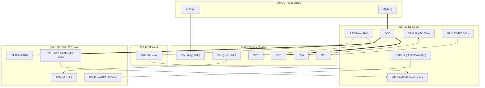

# ESP32-S3-GEEK Circuit Schematic & Hardware Wiring Guide

This document specifies the complete wiring and hardware schematic for connecting the **Waveshare ESP32-S3-GEEK**, **TI INA219 Current/Power Sensor**, **Nidec 00H220H012 12V BLDC Diaphragm Pump**, and a **12V DC Power Supply**.

---

## 1. Electrical Architecture & Safety Rules

> [!CAUTION]
> **Logic Level Safety (3.3V vs 12V):**
> - The ESP32-S3 GPIO pins (including GPIO 6 and GPIO 14) operate at **3.3V LVCMOS logic** and are **NOT 5V or 12V tolerant** ($V_{max} \approx 3.6\text{V}$).
> - **NEVER** pull up the FG sense line to the 12V rail.
> - The Nidec 00H220H012 FG output is an **Open-Collector / Open-Drain** circuit. It only sinks to Ground when active and floats when inactive. Pulling it up to the **ESP32 3.3V rail** via a **10 kΩ resistor** safely clamps the signal between 0V and 3.3V.

> [!IMPORTANT]
> **Common Ground Reference:**
> The **12V Power Supply Ground (–)** and the **ESP32-S3-GEEK Ground** **MUST be tied together**. Without a common ground reference:
> 1. The motor's internal FG transistor cannot pull GPIO 6 low relative to the ESP32 ground.
> 2. The PWM drive signal from GPIO 14 cannot be referenced properly by the motor's internal driver.

> [!NOTE]
> **Filtering Capacitor:**
> **Do not install a capacitor between FG sense and Ground.** A capacitor creates an RC filter with the 10 kΩ pull-up that distorts the sharp falling edges required by the Zephyr GPIO edge ISR.

---

## 2. Complete ASCII Schematic

```text
 +12V Power Supply (+)
        │
        │                                 ┌──────────────────────────────┐
        └─────────────────► [ VIN+ ]      │      INA219 Breakout         │
                            [      ]──────┤  (Measures 12V bus voltage   │
        ┌─────────────────► [ VIN- ]      │   & motor load current)      │
        │                                 │                              │
        │    ┌────────────► [ VCC  ]      │  VCC: 3.3V                   │
        │    │  ┌─────────► [ GND  ]      │  GND: Common GND             │
        │    │  │  ┌──────► [ SCL  ]      │  SCL: GPIO 17                │
        │    │  │  │  ┌───► [ SDA  ]      │  SDA: GPIO 16                │
        │    │  │  │  │                   └──────────────────────────────┘
        │    │  │  │  │
        │    │  │  │  │                   ┌──────────────────────────────┐
        │    │  │  │  └─────────────────► │ GPIO 16 (I2C0 SDA)          │
        │    │  │  └────────────────────► │ GPIO 17 (I2C0 SCL)          │
        │    │  │                         │                              │
        │    ├──┴───────────────────────► │ 3.3V Out                     │
        │    │   │                        │                              │
        │    │  [R] 10 kΩ Pull-up         │                              │
        │    │   │                        │                              │
        │    │   ├──────────────────────► │ GPIO 6   (Motor FG Input)    │
        │    │   │  ┌───────────────────► │ GPIO 14  (Motor PWM Output)  │
        │    │   │  │  ┌────────────────► │ GND                          │
        │    │   │  │  │                  └──────────────────────────────┘
        │    │   │  │  │                          ESP32-S3-GEEK
        │    │   │  │  │
        ▼    │   │  │  ▼
      [RED]  │ [YEL]│ [BLK]
      (VCC)  │ (FG) │ (GND)
   ┌─────────┴───┬──┴──┬──────────────────┐
   │             │   [BLU] (PWM)          │
   │             │     ▲                  │
   │             │     │                  │
   │             └─────┼──────────────────┘
   │                   │
   │         Nidec 00H220H012             │
   │       12V BLDC Diaphragm Pump        │
   └──────────────────────────────────────┘
        ▲
        │
 12V Supply (–) ───► Common GND
```

---

## 3. High-Side Power & Signal Flow



---

## 4. Hardware Pin Mapping Table

| Component | Pin / Wire | Connection Target | Function & Specifications |
| :--- | :--- | :--- | :--- |
| **12V DC Supply** | `+12V (+)` | INA219 **`VIN+`** | High-side power input to shunt resistor |
| | `GND (–)` | **Common GND** | Tied to ESP32-S3 `GND` and Pump `Black` wire |
| **INA219 Sensor** | `VIN+` | 12V Power Supply `+` | High-side voltage sense ($0\sim26\text{V}$) |
| | `VIN-` | Motor **Red Wire (`+12V`)** | Current feeds motor after passing $0.1\,\Omega$ shunt |
| | `VCC` | ESP32-S3 **`3.3V`** | Sensor logic power (draws $<1\text{ mA}$) |
| | `GND` | **Common GND** | Sensor reference ground |
| | `SCL` | ESP32-S3 **`GPIO 17`** | I2C0 Clock line (100 kHz standard mode) |
| | `SDA` | ESP32-S3 **`GPIO 16`** | I2C0 Data line |
| **Nidec 00H220H012** | **Red** (`VCC`) | INA219 **`VIN-`** | 12V motor operating voltage ($I \le 250\text{ mA}$) |
| | **Black** (`GND`) | **Common GND** | Motor DC return path |
| | **Yellow** (`FG`) | ESP32-S3 **`GPIO 6`** | Open-collector tachometer pulse; pull up to 3.3V with 10 kΩ |
| | **Blue** (`PWM`) | ESP32-S3 **`GPIO 14`** | 25 kHz active-low speed control |
